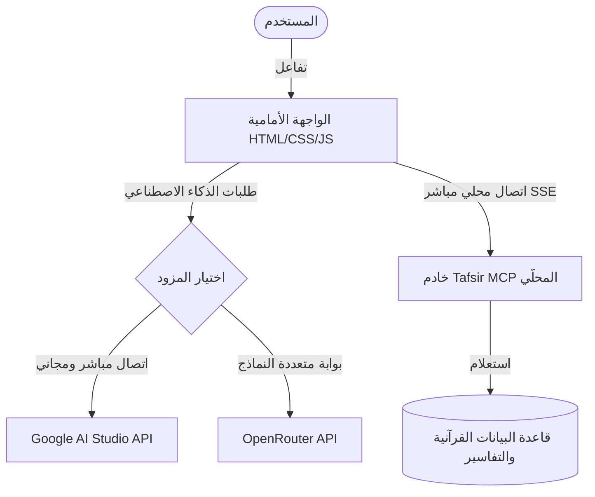

# فَسِّرْلي (Fasserly) — الباحث والمفسّر القرآني الذكي
> **Smart Quranic Search & Tafsir Client using Model Context Protocol (MCP)**

[](LICENSE)
[](https://www.python.org)
[](https://www.php.net)
[](https://modelcontextprotocol.io)

---

### [English Documentation](#english-version) | [الدليل باللغة العربية](#العربية)

---

<a name="العربية"></a>

## العربية

**فَسِّرْلي** هو تطبيق ويب متكامل ومصمم بجماليات إسلامية راقية، يدمج الذكاء الاصطناعي مع أدوات العلوم القرآنية الموثقة. يعتمد التطبيق على بروتوكول سياق النموذج (**Model Context Protocol - MCP**) للربط بين نماذج الذكاء الاصطناعي (مع دعم مرن لمزودين: **Google AI Studio** المباشر و**OpenRouter**) وبين قاعدة بيانات تفاسير القرآن الكريم وإعرابه اللغوي وأسباب النزول المعتمدة، لمنع الهلوسة العلمية وتقديم إجابات مسندة تمامًا.

### 🌟 الميزات الرئيسية
* **البحث والتفسير المعتمد:** استخراج تفاسير الآيات من أمهات كتب التفسير (تفسير ابن كثير، الجلالين، الطبري، إلخ).
* **أسباب النزول:** معرفة أسباب نزول الآيات والسور مع بيان درجة صحة الأثر الوارد.
* **التحليل النحوي والإعراب:** تقديم إعراب تفصيلي لبنية الكلمات والجمل القرآنية.
* **إحصاءات الجذور اللغوية:** البحث اللغوي المتعمق عن جذور الكلمات وتكرارها في القرآن.
* **مرونة اختيار مزود الذكاء الاصطناعي (Multi-Provider Support):**
  - **Google AI Studio**: اتصال مباشر وسريع ومجاني بأحدث نماذج Gemini الرسمية (`Gemini 3.5 Flash Lite`، `Gemini 3.8 Flash`، `Gemini 4 Argon`).
  - **OpenRouter**: بوابة شاملة تدعم نفس النماذج المعتمدة (`Gemini 3.5 Flash Lite`، `Gemini 3.8 Flash`، `Gemini 4 Argon`).
* **واجهة مستخدم إسلامية راقية:** تصميم عصري جذاب يعتمد على تدرجات لونية متناغمة (ألوان إسلامية ذهبية وخضراء)، تأثيرات الزجاج (Glassmorphism)، وخطوط عربية كلاسيكية جميلة (Amiri, Tajawal, Reem Kufi).
* **إدارة الاتصال الآمن:** إدخال مفتاح المزود المفضل وحفظه محليًا بأمان تام في متصفحك (`localStorage`).

---

### 🏗️ بنية وهيكلية النظام (Architecture)

يعمل المشروع وفق نموذج ثلاثي الطبقات يضمن السرعة وتجاوز قيود CORS المحلية:



---

### 🚀 متطلبات التشغيل (Prerequisites)
1. **بايثون (Python 3.8 أو أحدث):** لتشغيل خادم Tafsir MCP.
2. **متصفح ويب حديث:** لفتح واجهة المستخدم مباشرة (لا يشترط وجود خادم ويب محلي كـ XAMPP).
3. **مفتاح اتصال الذكاء الاصطناعي:** إما مفتاح مجاني من **Google AI Studio** (`aistudio.google.com`) أو مفتاح من **OpenRouter** (`openrouter.ai`).

---

### 🛠️ طريقة التثبيت والتشغيل بالتفصيل

#### الخطوة 1: تشغيل خادم التفسير المحلي (Tafsir MCP Server)
يحتوي المشروع على ملف دفعي (`start_server.bat`) يقوم تلقائيًا بتهيئة الخادم وتنزيل الاعتمادات وقاعدة البيانات.

* **باستخدام ملف bat (ويندوز):**
  قم بالنقر المزدوج على ملف `start_server.bat` وسيقوم بالآتي:
  1. التحقق من وجود بايثون.
  2. تثبيت مكتبة `tafsir-mcp` ومستلزماتها.
  3. تنزيل قاعدة البيانات القرآنية (بحجم ~214MB تقريبًا، وتُنزّل لمرة واحدة فقط).
  4. تشغيل خادم MCP المحلي على المنفذ `http://localhost:8000/sse`.

* **الطريقة اليدوية (عبر الطرفية):**
  إذا كنت تستخدم نظام تشغيل آخر أو تفضل العمل يدويًا:
  ```bash
  # 1. تثبيت الاعتمادات
  pip install -r requirements.txt

  # 2. تشغيل الخادم
  python run_tafsir.py
  ```

#### الخطوة 2: تشغيل الواجهة الأمامية
بفضل التعديلات المعمارية الجديدة والاستغناء عن XAMPP، يمكنك تشغيل الواجهة بأبسط الطرق:
1. ببساطة افتح ملف `index.html` في متصفح الويب المفضل لديك بالضغط المزدوج عليه.
2. أو يمكنك استخدام إضافة (Live Server) في VS Code، أو تشغيل أي خادم HTTP بسيط جدًا.

#### الخطوة 3: ربط الذكاء الاصطناعي وبدء الاستخدام
1. عند فتح التطبيق، اضغط على زر **"إعدادات الاتصال والمفتاح"** في القائمة الجانبية.
2. اختر **مزود الخدمة** المفضل لديك:
   - **Google AI Studio**: أدخل مفتاحك المجاني (`AIza...`)، واختر أحد النماذج المعتمدة (`Gemini 3.5 Flash Lite` الافتراضي، أو `Gemini 3.8 Flash`، أو `Gemini 4 Argon`).
   - **OpenRouter**: أدخل مفتاحك (`sk-or-v1-...`)، واختر نموذجك المفضل (`Gemini 3.5 Flash Lite` الافتراضي، أو `Gemini 3.8 Flash`، أو `Gemini 4 Argon`).
3. اضغط على **"حفظ الإعدادات وبدء الاتصال"**.
4. ستلاحظ تحول نقطة الحالة بالأسفل إلى اللون الأخضر لتؤكد الاتصال بنجاح. ابدأ الآن في طرح أسئلتك القرآنية!

---

### 📂 ملفات المشروع (Project Structure)
* `index.html`: هيكل واجهة المستخدم والتنسيقات الهيكلية ونوافذ الإعدادات.
* `styles.css`: تنسيقات الواجهة ونظام الألوان الإسلامي والمؤثرات البصرية.
* `app.js`: منطق التحكم، إدارة المحادثة، محاكاة بروتوكول MCP للمتصفح، والتواصل مع Google AI Studio وOpenRouter.
* `run_tafsir.py`: الكود المشغل لخادم بايثون Tafsir MCP (مزود بـ CORS لتسهيل الاتصال).
* `start_server.bat`: ملف دفعي لتثبيت وتشغيل خادم بايثون في بيئة ويندوز بضغطة زر.
* `requirements.txt`: الحزم البرمجية المطلوبة لخادم بايثون.
* `.gitignore`: قائمة بالملفات المؤقتة والملفات غير المرغوب في تتبعها برمجياً.
* `LICENSE`: ترخيص المشروع (MIT).

---

<a name="english-version"></a>

## English Version

**Fasserly** is a beautifully crafted web application with a premium Islamic aesthetic, combining Generative AI with authenticated Quranic sciences. Leveraging the **Model Context Protocol (MCP)**, Fasserly bridges advanced LLMs (supporting both direct **Google AI Studio** and **OpenRouter**) with local Quranic databases (tafsir, parsing, syntax, and reasons of revelation) to prevent AI hallucinations and provide verified references.

### 🌟 Key Features
* **Verified Tafsir Lookup:** Fetch explanations from authoritative tafsirs (Ibn Kathir, Al-Jalalayn, Al-Tabari, etc.).
* **Nuzool Reasons:** Explore reasons of revelation for verses with authentication metadata.
* **Grammatical Parsing & Syntax:** Access detailed Arabic grammar (I'rab) and morphology analysis.
* **Word Roots Statistics:** Search and display occurrences and statistical weights of root words.
* **Multi-Provider AI Flexibility:**
  - **Google AI Studio**: Direct, fast, and free API integration with the latest official Gemini models (`Gemini 3.5 Flash Lite`, `Gemini 3.8 Flash`, `Gemini 4 Argon`).
  - **OpenRouter**: Universal hub supporting the same models (`Gemini 3.5 Flash Lite`, `Gemini 3.8 Flash`, `Gemini 4 Argon`).
* **Premium Islamic Aesthetic:** Elegant dark/light glassmorphic UI, tailored with custom golden and emerald gradients, smooth animations, and classical Arabic typography (Amiri, Tajawal, Reem Kufi).
* **Safe Local Settings:** Save your chosen provider keys locally in the browser's `localStorage` securely.

---

### 🚀 Getting Started

#### Step 1: Run the Tafsir MCP Python Server
The repository includes a batch script to automate server setup.

* **On Windows (using the bat script):**
  Double-click `start_server.bat`. It will check for Python, install `tafsir-mcp` and `uvicorn`, download the ~214MB Quran database (one-time download), and launch the SSE server on `http://localhost:8000/sse`.

* **Manual Setup (Cross-platform):**
  ```bash
  # 1. Install dependencies
  pip install -r requirements.txt

  # 2. Run the server
  python run_tafsir.py
  ```

#### Step 2: Open the Frontend
1. Since the app communicates directly with the Python server via CORS, you no longer need XAMPP or Apache.
2. Simply double-click `index.html` to open it in your browser.
3. Alternatively, you can use any simple HTTP server (like VS Code Live Server).

#### Step 3: Configure settings
1. Click the **"إعدادات الاتصال والمفتاح"** (Connection & Key Settings) button on the sidebar.
2. Choose your preferred **AI Provider**:
   - **Google AI Studio**: Paste your free Gemini API Key (`AIza...`) and select your model (`Gemini 3.5 Flash Lite`, `Gemini 3.8 Flash`, or `Gemini 4 Argon`).
   - **OpenRouter**: Paste your OpenRouter API Key (`sk-or-v1-...`) and select your model (`Gemini 3.5 Flash Lite`, `Gemini 3.8 Flash`, or `Gemini 4 Argon`).
3. Click **"حفظ الإعدادات وبدء الاتصال"** (Save & Connect).
4. The status indicator will turn green, indicating the system is ready for queries!

---

### 📂 Repository Contents
* `index.html`: The markup of the chat dashboard and settings modal.
* `styles.css`: Custom Islamic-themed stylesheet.
* `app.js`: Main frontend logic, SSE handling, tiny MCP client, and multi-provider AI client (Google AI Studio & OpenRouter).
* `run_tafsir.py`: Python script launching the local Tafsir MCP server (with built-in CORS).
* `start_server.bat`: Windows batch script for automated environment setup.
* `requirements.txt`: Python package requirements.
* `.gitignore`: Excluded temporary and system files from git.
* `LICENSE`: MIT License.

---

## 📜 رخصة الاستخدام / License
هذا المشروع مرخص بموجب رخصة **MIT**. لمزيد من التفاصيل راجع ملف [LICENSE](LICENSE).
This project is licensed under the **MIT License**. For details, see the [LICENSE](LICENSE) file.
